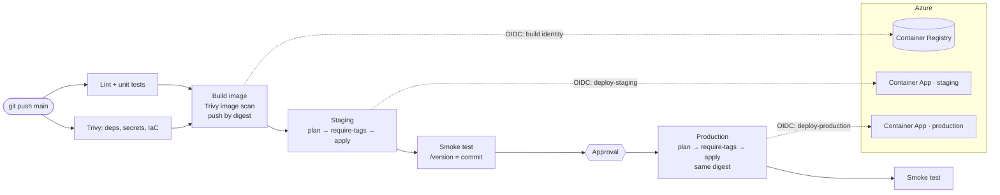

# Azure Golden Path Template

A reusable template that lets a team ship a service to Azure safely **without writing its own pipeline**.
A team edits one file, `golden-path.yaml`, pushes to `main`, and gets a tested, scanned, tagged service
running on Azure Container Apps in staging, then production after an approval.

- **Infrastructure as code**: Terraform for everything, from the registry and state store to the running app.
- **No stored secrets**: GitHub Actions logs in to Azure with OIDC. Four separate identities, each trusted for one
  workflow context and given only the roles it needs. The app pulls its image with a managed identity.
- **Security scanning built in**: Trivy scans dependencies, secrets, Terraform/Dockerfile misconfigurations and the
  built image. Fixable HIGH/CRITICAL findings block the build; full results go to GitHub code scanning.
- **Staging, then production**: the image is built and scanned once, pushed by digest, smoke-tested in staging,
  and the *same digest* is promoted to production behind a required reviewer.
- **Custom tag gate**: [`actions/require-tags`](actions/require-tags), a GitHub Action written in Python and packaged with
  Docker, reads the Terraform plan and blocks the deployment if any Azure resource is missing a required tag.
- **Automated dependency fixes**: the [Vulnerability Remediation Agent](#vulnerability-remediation-agent) runs on the repo
  weekly and opens pull requests for safe upgrades. It never merges.



## Repository layout

| Path | What it is |
|---|---|
| `golden-path.yaml` | The service manifest: name, owner, cost center, data classification, sizing, scaling. |
| `app/` | Sample Python API (FastAPI), Dockerfile, tests and service-specific smoke checks. |
| `infra/bootstrap/` | One-time setup: registry, state storage, per-environment resource groups and OIDC identities. |
| `infra/modules/container-app/` | Reusable module: Log Analytics, Container Apps environment, Container App with probes and autoscaling. |
| `infra/service/` | Root module the pipeline applies per environment; reads everything from `golden-path.yaml`. |
| `actions/require-tags/` | Custom Docker action (Python) that blocks plans with missing or invalid tags. |
| `.github/workflows/golden-path.yml` | Reusable pipeline: test → scan → build → staging → production. |
| `.github/workflows/deploy.yml` | The only pipeline file a service owns: a 20-line call to the golden path. |
| `.github/workflows/pr.yml` | Pull request checks, including a read-only plan and tag gate commented on the PR. |
| `.github/workflows/remediation.yml` | Weekly run of the Vulnerability Remediation Agent. |
| `.github/actions/` | Composite actions for "plan, gate, apply" and smoke tests, shared by both environments. |
| `scripts/` | `configure-github.sh` wires the repo to Azure; `lead_time.py` measures repo-to-running time. |

## Ship a new service

Full walkthrough: [docs/getting-started.md](docs/getting-started.md). In short:

1. **Use this template** on GitHub to create the service repository.
2. Edit `golden-path.yaml` (name, owner, cost center, data classification) and replace `app/` with your service.
3. Run the one-time bootstrap with an Azure account that can assign roles:
   ```bash
   cd infra/bootstrap
   cp terraform.tfvars.example terraform.tfvars   # subscription, repo name
   terraform init && terraform apply
   ```
4. Connect the repository: `scripts/configure-github.sh`
5. Push to `main`. The service is live in staging when the run finishes, and in production once approved.

## The require-tags action

```yaml
- uses: ./actions/require-tags
  with:
    plan-json: infra/service/tfplan.json        # terraform show -json tfplan
    required-tags: owner,cost-center,environment,service,data-classification
    allowed-values: |
      environment=staging|production
      data-classification=public|internal|confidential
```

It checks every managed resource the plan will create or update, skips resource types that cannot be tagged,
matches tag names case-insensitively (as Azure does), and reports values only known after apply as warnings
(or errors with `fail-on-unknown: true`). Failures appear as annotations and a job summary table:

```
## Required tags check: ❌ Blocked
| Resource                     | Tag          | Problem                                               |
|------------------------------|--------------|-------------------------------------------------------|
| azurerm_key_vault.shadow     | owner        | missing: required tag is missing or empty             |
| ...container_app_environment | environment  | invalid: value 'dev' is not one of: staging, production |
```

Details and all inputs: [actions/require-tags/README.md](actions/require-tags/README.md).

## Security model

| Identity | Trusted OIDC subject | Roles |
|---|---|---|
| `gh-build` | `repo:<owner>/<repo>:ref:refs/heads/main` | AcrPush on the registry |
| `gh-plan` | `repo:<owner>/<repo>:pull_request` | Reader on env resource groups, Blob Data Reader on state |
| `gh-deploy-<env>` | `repo:<owner>/<repo>:environment:<env>` | Contributor on **its own** resource group, Blob Data Contributor on state |
| `app-<env>` (runtime) | — (managed identity on the Container App) | AcrPull |

More in [docs/security.md](docs/security.md): why there are no secrets, how the stages are isolated, and what each scan gate blocks.

## Vulnerability Remediation Agent

`remediation.yml` runs the agent every Monday (and on demand). It scans the code and image, picks the smallest safe upgrade,
runs the tests, and opens a pull request only if they pass; otherwise it opens an issue. Branch protection on `main`
means a person always reviews and merges. Azure OpenAI is reached with a short-lived token from OIDC, so no API key is stored.
Set `REMEDIATION_AGENT_IMAGE` (and `REMEDIATION_AGENT_ARGS` if your agent's CLI differs) to turn it on.

## Measuring "repo to running"

Each deploy run's summary shows *commit to running in staging*. For the end-to-end number for a new service:

```bash
python3 scripts/lead_time.py sk-haaga/<service-repo>
```

It reads GitHub's own records: repository creation → first successful staging deployment. See
[docs/measuring-lead-time.md](docs/measuring-lead-time.md).

## Local development

```bash
make install   # dev dependencies
make test      # app + action unit tests
make lint
make run       # http://localhost:8000/docs
make scan      # Trivy, same gates as CI (needs trivy and docker)
make tag-check-demo
```

## License

MIT
