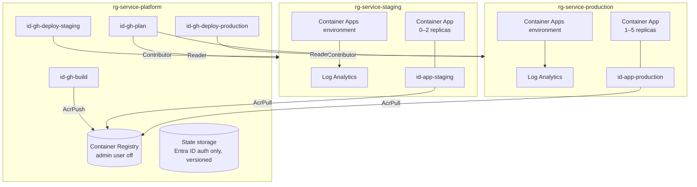

# Architecture

## Azure resources

Bootstrap (`infra/bootstrap`) owns everything in the platform group plus the resource groups and app identities.
The pipeline (`infra/service` → `infra/modules/container-app`) owns only what is inside each environment's
group. That split is what lets the deploy identities be scoped to a single resource group.

## Who owns what

| Layer | Owned by | Changed how |
|---|---|---|
| `golden-path.yaml`, `app/` | Service team | Pull request |
| `deploy.yml` | Service team (but it is a 20-line call) | Rarely |
| `golden-path.yml`, composite actions, `actions/require-tags` | Platform | Pull request, CODEOWNERS review |
| `infra/modules`, `infra/service` | Platform | Pull request, CODEOWNERS review |
| `infra/bootstrap` | Platform, run by a person | Once per service |

## Pipeline

| Job | Identity | Does |
|---|---|---|
| prepare | none | Validates configuration, reads the manifest, starts the clock |
| test | none | ruff + pytest |
| scan-source | none | Trivy filesystem scan, SARIF to code scanning, gate on fixable HIGH/CRITICAL |
| build | build | `docker build`, Trivy image scan and gate, push, resolve digest |
| staging | deploy-staging | plan → require-tags → apply → smoke test |
| production | deploy-production | approval → plan → require-tags → apply (same digest) → smoke test |

Revisions run in `Single` mode with probes: a new revision only receives traffic once its readiness probe passes,
so a broken image does not replace a healthy one, and the smoke test fails the run.

## Design choices

- **Managed identities with federated credentials instead of Entra app registrations.** Bootstrap needs only
  Azure RBAC rights, not directory permissions, and there is nothing to rotate.
- **Manifest-driven Terraform.** `infra/service` reads `golden-path.yaml` with `yamldecode`, so teams change
  sizing and tags without touching HCL, and the same values feed the tag gate.
- **Gate the plan, apply the plan.** `terraform apply tfplan` applies the exact plan file the tag check approved.
- **Build once, promote by digest.** Production never rebuilds.
